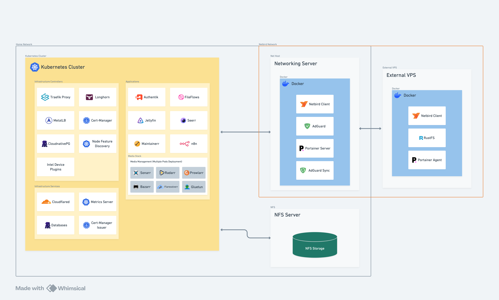

# Homelab

GitOps configuration of a home server infrastructure. Project contains services for smart home, media, automations, data storage, and more. It is a fully working configuration.

<details>
<summary><strong>What is a Homelab?</strong></summary>

A homelab is a personal home network with one or more servers and services running on it. It is typically used for learning, experimenting, and hosting personal services. Hosting AI agents has recently become popular in the homelab community, but this repo is focused on standard infrastructure. A full definition and a vibrant community can be found on [r/homelab](https://www.reddit.com/r/homelab/).

</details>

## Overview

This repo contains two main modules — Docker and Kubernetes. Docker is used for core services that the network depends on, or for services hosted externally. Kubernetes is used for everything else.

The diagram below provides a simplified overview of this repo's architecture.



For more information on why this may seem overkill, go to [Philosophy and Rules](#philosophy-and-rules).

### Core Services

Core (Docker) services are kept in the [Docker folder](docker).

These services include mostly networking (DNS, DHCP, VPN, etc.). For more details, see the [Docker README](docker/README.md).

### External Services

Since it is strongly advised not to store backups or critical data on home servers, some services are hosted externally. Currently, the author uses S3 storage hosted on an [OCI VPS](https://www.oracle.com/cloud/) running [RustFS](https://rustfs.com) and [Termix](https://github.com/termix-ssh/termix) for server management.

The VPS is connected to the home network using Netbird, which allows it to be managed from self-hosted Portainer and exposes its services only within the homelab network.

> [!NOTE]
> The VPS does not belong to the Kubernetes cluster, as it would be a security risk and bottleneck.

> [!WARNING]
> Connecting a VPS to a home network via VPN has security implications and should be carefully considered. Usually VPS should have access constrained by firewall rules. In this repo it is done by Netbird rules.


### Kubernetes Cluster

The heart of this homelab — it is the default place where services and apps live. For simplicity and resource efficiency, it is managed declaratively via [Flux](https://fluxcd.io).

GitOps config contains apps, services, secrets and configurations. Traefik is used as ingress controller, Longhorn for storage, Netbird for secure access.

## Philosophy and Rules

This project is focused on being stable, robust and reliable, while also being easy to manage and update. It may seem like overkill, but it's really convinient and zero-failure.

Network is separated, most of services are hidden behind VPN. Public services are exposed using Cloudflare Tunnels and secured by Cloudflare Access (Zero Trust). 

Data are backuped up remotely and locally. Moreover, for most of services data are replicated to at least two nodes. 

Cluster is separated and access is limited even from inisde the network.

## Development Workflow

This repo has minimal workflow - cluster fetches new commits and applies changes.

A few tools are used to make the workflow safer, easier, and more convenient - Prek, some LLMs (most Gemini), some scripting, K9S, Portainer.

### Quick Commands

```bash
# Encrypt all secrets (before committing)
./encrypt-secrets.sh
```

## Tech Stack Summary


